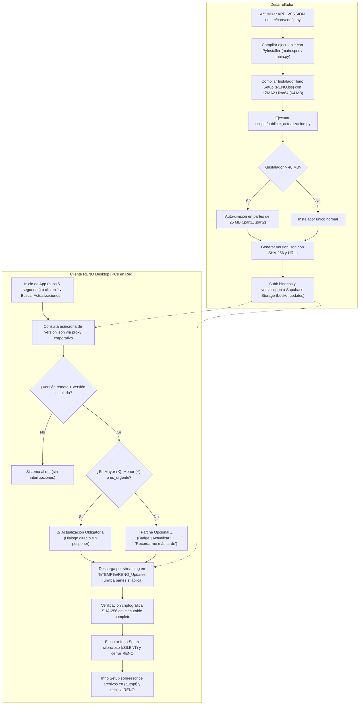

# Instructivo Oficial: Publicación de Actualizaciones Automáticas (OTA) — RENO

Este documento detalla el procedimiento para empaquetar, compilar, verificar y publicar nuevas versiones de **RENO** utilizando el sistema de actualizaciones automáticas adoptado del estándar de **CRONO-PCT**.

---

## 1. Arquitectura del Sistema de Actualizaciones



---

## 2. Solución al Límite de 50 MB de Supabase Storage (Free Tier)

El plan gratuito de Supabase impone un límite estricto de **50 MB por archivo**. Para garantizar que nunca se rechacen instaladores (`413 Payload Too Large`), el sistema implementa **dos capas de protección**:

1. **Capa 1 — Compresión Ultra64 (64 MB Dictionary) en `RENO.iss`:**
   Configura Inno Setup con el ratio de compresión más alto de la industria:
   ```pascal
   Compression=lzma2/ultra64
   InternalCompressLevel=ultra64
   SolidCompression=yes
   LZMAUseSeparateProcess=yes
   LZMANumBlockThreads=4
   ```
   *Resultado:* Reduce el instalador de ~60 MB a **~38–42 MB**, ingresando directamente en Supabase sin superar el límite.

2. **Capa 2 — Blindaje Multi-Parte (`.part1`, `.part2`) en `scripts/publicar_actualizacion.py`:**
   Si en el futuro se incorporan más librerías y el instalador supera los **48 MB**:
   - El script lo divide automáticamente en fragmentos de **~25 MB** (`.part1`, `.part2`).
   - El worker de RENO descarga ambos fragmentos secuencialmente en segundo plano, los concatena en el archivo destino final y verifica el hash SHA-256 completo antes de ejecutarlo.

---

## 3. Criterio de Obligatoriedad (SemVer)

- **Versiones Mayores (`X.0.0`) y Menores (`2.Y.0`):** Se consideran **OBLIGATORIAS**. Alertan al usuario de que debe actualizar para mantener la integridad de sincronización con la base de datos o Supabase.
- **Versiones Parche (`2.0.Z`):** Se consideran **OPCIONALES**. El usuario puede actualizar inmediatamente o elegir *"Recordarme más tarde"*.
- **Flag `obligatoria: true` en `version.json`:** Permite forzar la actualización de cualquier versión específica (incluso parches) si resuelve un fallo crítico de seguridad.

---

## 4. Guía Paso a Paso para Publicar una Nueva Versión

### Paso 1: Actualizar la versión en el código
En `src/core/config.py`, cambiar `VERSION`:
```python
VERSION = "2.0.1"
```

### Paso 2: Compilar el ejecutable con PyInstaller
```powershell
python -m PyInstaller --clean --noconfirm main.spec
```

### Paso 3: Compilar el instalador con Inno Setup
1. Abrir `RENO.iss` en **Inno Setup Compiler**.
2. Presionar **F9** (o *Build > Compile*).
3. Se generará el instalador optimizado en `Instalador/RENO_Setup_v2.0.1.exe` (~39 MB).

### Paso 4: Generar el manifiesto con el script CLI
Ejecutar el publicador automático:
```bash
python scripts/publicar_actualizacion.py --version-app 2.0.1 --titulo "Mejoras en Reemplazos y Sincronización"
```

El script:
- Verificará `Instalador/RENO_Setup_v2.0.1.exe`.
- Calculará el hash SHA-256 y tamaño exacto.
- Si supera los 48 MB, generará las partes `.part*` automáticamente.
- Creará `Instalador/version.json` y `Instalador/reno_version.json`.

### Paso 5: Subir los archivos a Supabase Storage

**Opción A — Subida Automática Desatendida con `.env` (Estándar Horos / Recomendado):**
Configure sus credenciales en el archivo local `.env` (puede copiar `.env.example` como `.env`):
```env
SUPABASE_URL=https://tu-proyecto.supabase.co
SUPABASE_SERVICE_KEY=sb_secret_tu_clave_secreta_aqui
SUPABASE_STORAGE_BUCKET=updates
```
Luego ejecute el script sin necesidad de pasar claves en la consola (subirá automáticamente si detecta credenciales reales en `.env`, o puede forzar `--subir` / `--supabase`):
```bash
python scripts/publicar_actualizacion.py --version-app 2.0.1
```
El script soporta tanto claves modernas (`sb_secret_...`) como JWT legacy (`service_role`), creará el bucket si hace falta y subirá automáticamente `version.json`, `reno_version.json` y el instalador o partes (`.part1`, `.part2`, ...) a Supabase Storage con soporte de sobreescritura (`x-upsert: true`). Si solo desea generar los archivos localmente sin subir, agregue `--no-subir`.

**Opción B — Subida Manual desde Supabase Dashboard:**
1. Abrir el panel de Supabase > **Storage** > bucket **`updates`**.
2. Subir manualmente:
   - `RENO_Setup_v2.0.1.exe` (o los fragmentos `.part*`).
   - `version.json` y `reno_version.json`.

---

## 5. Verificación en el Cliente

1. Al abrir RENO en cualquier PC conectada, a los **5 segundos** del inicio el sistema consultará silenciosamente el manifiesto.
2. Si detecta la nueva versión:
   - Si es **Parche Z**: Mostrará el botón en la cabecera `🚀 ¡Actualizar a v2.0.1!` y un aviso flotante Toast.
   - Si es **Mayor/Menor (X/Y)**: Abrirá directamente el diálogo modal destacando la actualización como requerida.
3. El usuario o administrador también puede forzar la búsqueda en cualquier momento desde:
   - **Menú Archivo > 🚀 Buscar Actualizaciones...**
   - **Botón `RENO vX.Y.Z` (esquina superior derecha) > 🔍 Buscar Actualizaciones...**
